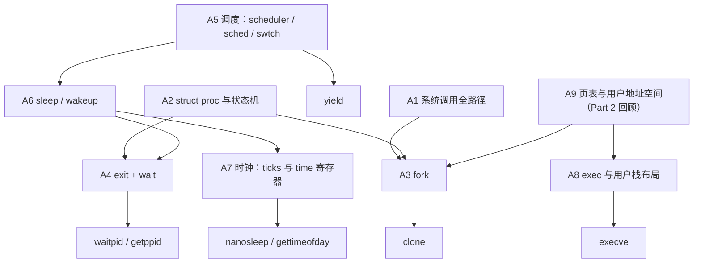

# 0. 学习路线图

本文件有两条路线：

- **路线 A：面测准备**（xv6-k210 Lab Part 1~3）：时间紧，优先完成。
- **路线 B：xv6-riscv 整体学习**：面测之后按部就班推进。

两条路线有交集：路线 A 的大部分内容就是路线 B 的 B3（进程）加上 B1、B2、B4 的一部分。所以做完路线 A，路线 B 也会推进一大截。

---

# 路线 A：面测准备

## A.0 面测范围与原则

| Part | 内容 | 状态 |
|---|---|---|
| Part 1 | 系统调用：关机与简单调用（shutdown、getcwd、write、getpid、times、uname） | 已完成 |
| Part 2 | 系统调用：内存分配管理（brk、mmap、munmap，以及 openat、close、read、fstat） | 已完成 |
| Part 3 | 系统调用：进程管理（10 个测试） | **未完成** |

原则：

1. **读 xv6-k210 的代码**，因为面测问的是你的实现。它基于较老的 xv6（`sleep(chan, lk)` 旧接口、`kpagetable`、`copyout2`），概念与上游相通。
2. **边学边实现**：每学完一个知识点，就把依赖它的测试做掉。
3. 每个知识点都要能用"**是什么 → 为什么 → 怎么做（指到代码行） → 坑**"四句话讲清楚。

## A.1 知识点依赖图

## A.2 执行顺序与清单

每一步：先学知识点，再实现对应的测试，最后用自测题检验。

### 第 1 步：系统调用全路径（A1）　面测必问 · Part 1 的全部问题都在这里

- [ ] 对照 k210 代码走一遍：`usys.pl` 桩代码 → `ecall` → `trampoline.S`(uservec) → `trap.c`(usertrap, scause==8, epc+=4) → `syscall.c`(a7 查表) → `argint`/`argaddr`/`argstr` → `copyout2` → 返回值写 `trapframe->a0` → `usertrapret` → userret → `sret`
- [ ] 两套编号：系统调用号（U↔S）与 SBI 功能号（S↔M）
- [ ] Linux ABI 适配：为什么要改调用号；`SYS_xxx_xv6` 双编号共存

自测：
1. 参数在内核里从哪里取？指针参数为什么不能直接解引用？（k210 为什么又可以用 `copyout2` 直接 memmove？）
2. `epc += 4` 是为什么？
3. `sys_shutdown` 从用户到关机经过了哪几层？

### 第 2 步：`struct proc` 与进程状态机（A2）　面测必问

- [ ] 逐个字段说出作用：`state`、`pid`、`parent`、`killed`、`xstate`、`chan`、`kstack`、`sz`、`pagetable`、`kpagetable`、`trapframe`、`context`、`ofile[]`、`cwd`，以及你加的 `vmas[]`、时间统计字段
- [ ] 六种状态及转换（谁、在哪个函数里改的）
- [ ] 与 Linux `task_struct` 对照：`pid`/`tgid`、`state`、`parent`/`children`、`mm`（≈ pagetable + sz + vmas）、`files`（≈ ofile）、`fs`（≈ cwd）、`thread`（≈ context）
- [ ] trapframe 与 context 的区别（用户现场 / 内核现场）

自测：
1. 一个被换下 CPU 的进程，它的寄存器存在哪两个地方？
2. 为什么 xv6 用固定数组 `proc[NPROC]`，而 Linux 用链表？

### 第 3 步：fork（A3）→ 实现 **clone**、确认 **fork**

- [ ] `fork()`：`allocproc` → `uvmcopy`（k210 还要同步 `kpagetable`）→ 复制 trapframe → 子进程 `a0 = 0` → `filedup` → `parent` → RUNNABLE
- [ ] 子进程首次运行：`context.ra = forkret` → `usertrapret` → 从 `fork()` 返回 0
- [ ] **clone 的实现要点**：测试库的 `__clone` 把 `fn` 和 `arg` 存在**新栈**上，子进程执行 `ld a1, 0(sp)` 取函数指针，所以子进程的 `trapframe->sp` 必须设为参数 `stack`；`stack == 0` 时退化为 fork
- [ ] 实现：`SYS_clone` 220 → 新的 `sys_clone`（读 flags 和 stack）
- [ ] 测试：test_fork、test_clone

自测：
1. 父子进程返回值不同，是由哪一行代码决定的？
2. clone 和 fork 有什么区别？Linux 的 clone 还能共享什么（`CLONE_VM` 等）？你实现了哪些？
3. xv6 的 fork 是完整复制内存，Linux 用什么优化？（写时复制，COW）

### 第 4 步：exit + wait（A4）→ 实现 **waitpid**、**getppid**、确认 **wait**、**exit**

- [ ] `exit()`：关文件 → 释放 cwd → 释放 VMA → `reparent`（孤儿交给 init）→ 唤醒父进程 → `xstate = status` → ZOMBIE → `sched()` 永不返回
- [ ] `wait()`：扫描子进程 → 找到 ZOMBIE 就 `copyout2(xstate)` + `freeproc` → 有子进程但都没退出就 `sleep` → 没有子进程就返回 -1
- [ ] 为什么 exit 不能释放自己的内核栈（还在用）→ 所以需要僵尸状态
- [ ] **waitpid 的实现要点**：wait4 的 `pid` 参数（-1 表示任意子进程，>0 表示指定的子进程）；Linux 的 wstatus 编码：`WEXITSTATUS(s) = (s >> 8) & 0xff`，所以拷出时要 `xstate << 8`
- [ ] getppid：`p->parent->pid`（读 parent 时要不要加锁？）
- [ ] 测试：test_wait、test_waitpid、test_getppid、test_exit

自测：
1. 什么是僵尸进程？由谁、在什么时候回收？
2. 父进程先退出，子进程怎么办？init 为什么不能退出？
3. wait 睡在哪个 chan 上？谁来唤醒它？

### 第 5 步：调度（A5）→ 实现 **yield**

- [ ] `scheduler()` 循环：找 RUNNABLE → RUNNING → `swtch`
- [ ] `yield()` → `sched()` → `swtch` 回到调度器；`sched` 里那几个 panic 检查各自防什么
- [ ] `swtch` 只保存 ra、sp、s0~s11 的原因
- [ ] `p->lock` 跨 swtch 持有：在 scheduler 加锁，在进程侧（yield / forkret）解锁
- [ ] 时钟中断如何触发抢占：`devintr` 返回 2 → `yield()`
- [ ] 实现：`SYS_sched_yield` 124 → `yield(); return 0;`
- [ ] 测试：test_yield（三个子进程交替输出）

自测：
1. yield 之后进程是什么状态？下次从哪里继续执行？
2. 调度算法是什么？（轮转）有什么缺点？

### 第 6 步：sleep / wakeup（A6）

- [ ] `sleep(chan, lk)`：为什么要传入一把锁；先拿 `p->lock` 再放 `lk` 的顺序为什么能避免唤醒丢失
- [ ] `wakeup(chan)`：把该 chan 上所有 SLEEPING 的进程改为 RUNNABLE
- [ ] 在 wait、pipe、`sys_sleep` 里各是怎么用的

自测：
1. sleep 和忙等有什么区别？
2. 如果先释放锁再去睡眠，会出现什么问题？

### 第 7 步：时钟（A7）→ 实现 **nanosleep**、**gettimeofday**

- [ ] k210 的时钟路径：`sbi_set_timer` → 时间到 → （RustSBI 转发）S 态时钟中断 → `timer_tick()` → `ticks++` → 重设下一次
- [ ] **频率问题**：`INTERVAL = 390000000/200` 是按 K210 的 390MHz 算的；QEMU virt 的 `time` 频率要先核实（通常是 10MHz）。一个 tick 实际是多少秒？
- [ ] nanosleep：从用户结构体读 `sec`/`usec`（或 `nsec`）→ 换算成 ticks → 复用 `sys_sleep` 的循环
- [ ] gettimeofday：`r_time()` → 按频率换算成 `sec`/`usec` → `copyout2`
- [ ] 测试：test_sleep（要求前后差 ≥ 1 秒）、test_gettimeofday

自测：
1. 时钟中断从硬件到 `ticks++` 经过了哪些步骤？SBI 在其中做了什么？
2. `ticks` 和 `time` 寄存器有什么区别？

### 第 8 步：exec（A8）→ 实现 **execve**

- [ ] `exec()`：读 ELF 头 → 新建页表 → 按 program header 加载各段 → 分配用户栈 → 拷贝 argv → **最后**才替换旧映像
- [ ] 为什么"成功不返回、失败才返回"
- [ ] **Linux 的栈布局**：测试程序的 `_start` 执行 `mv a0, sp`，`__start_main` 从栈上读 `argc = p[0]`、`argv = p+1`，所以栈顶要依次放 argc、argv 指针数组、NULL、envp……
- [ ] 实现：`SYS_execve` 221，读 path、argv、envp
- [ ] 测试：test_execve（exec 磁盘上的 `test_echo`）

自测：
1. exec 加载到一半失败了怎么办？
2. exec 之后，哪些东西保留（pid、打开的文件），哪些被替换（内存、寄存器）？

### 第 9 步：回顾 Part 2（A9）

- [ ] brk：`growproc` → `uvmalloc`/`uvmdealloc`；返回值的约定
- [ ] mmap/munmap：你的 `struct vma`、`vmas[NVMA]`；是立即分配还是懒分配；exit 和 exec 时为什么要 `vma_free_all`
- [ ] k210 的两套页表：`pagetable`（用户）与 `kpagetable`（内核，也映射了用户空间）
- [ ] 文件描述符三层：`ofile[]` → `struct file` → FAT32 目录项；openat 的相对路径（`dirfd`、`AT_FDCWD`）

自测：
1. mmap 与 brk 有什么区别？
2. munmap 之后再访问那块地址会发生什么？

### 第 10 步：模拟问答

- [ ] 把各步的自测题完整地讲一遍，讲不顺的回到对应步骤
- [ ] 准备三分钟的"我的实现概述"：每个 Part 改了哪些文件、遇到的最大问题和解决办法（可以参考 `_labnote/report.md`）

## A.3 Part 3 测试清单

| 测试 | 调用号 | 依赖步骤 | 现状（读代码判断，待实测） | 完成 |
|---|---|---|---|---|
| test_fork | clone 220 | 3 | 220 → `sys_fork`，大概率已通过 | [ ] |
| test_clone | clone 220 | 3 | 忽略了 stack 参数 | [ ] |
| test_exit | exit 93 | 4 | Part 1 已完成 | [ ] |
| test_wait | wait4 260 | 4 | 大概率已通过 | [ ] |
| test_waitpid | wait4 260 | 4 | 忽略 pid；wstatus 未按 `<< 8` 编码 | [ ] |
| test_getppid | 173 | 4 | 未实现 | [ ] |
| test_yield | sched_yield 124 | 5 | 未实现 | [ ] |
| test_sleep | nanosleep 101 | 6、7 | 未实现 | [ ] |
| test_gettimeofday | 169 | 7 | 未实现 | [ ] |
| test_execve | execve 221 | 8 | 只有 xv6 的 exec（7 号） | [ ] |

## A.4 答题框架

以"僵尸进程"为例：

1. **是什么**：已经调用 exit、但还没被父进程 wait 回收的进程，状态为 ZOMBIE。
2. **为什么需要**：exit 时还在使用自己的内核栈，不能释放自己；退出码也要保留给父进程读取。
3. **怎么做**：`exit()` 设置 `xstate` 和 ZOMBIE，唤醒父进程；父进程的 `wait()` 找到它，拷出退出码，调用 `freeproc` 释放资源（proc.c 第 xxx 行）。
4. **坑 / 扩展**：父进程先退出时，孤儿由 `reparent` 交给 init 回收；Linux 的 wstatus 要 `<< 8` 编码。

---

# 路线 B：xv6-riscv 整体学习

## B.0 总览

按 `main()` 的初始化顺序推进，每个阶段产出一篇笔记。难度分档见下表（一档最难）。

| 阶段 | 笔记 | 难度 | 状态 |
|---|---|---|---|
| B0 启动 | [1_bootstrapping.md](1_bootstrapping.md)、[2_kernel_init.md](2_kernel_init.md) | 广而浅 | 已完成 |
| B1 内存 | 3_memory.md | 二、三档 | |
| B2 陷入与系统调用 | 4_trap_syscall.md | 二档 | |
| B3 进程 | 5_process.md | 二档 | 面测路线会覆盖大部分 |
| B4 并发 | 6_concurrency.md | **一档** | |
| B5 文件系统 | 7_filesystem.md | **一档**（日志）+ 二档 | |
| B6 设备与中断 | 8_devices.md | 三档 | |
| B7 用户态程序 | 9_userland.md | 三档 | |

## B1 内存

- **要回答的问题**：物理内存怎么分配？虚拟地址怎么翻译？内核和用户各有怎样的地址空间？
- **文件**：kalloc.c（82 行）、vm.c（491 行）、memlayout.h、riscv.h 中与页表相关的宏
- **要点**
  - [ ] `kalloc`/`kfree`：空闲页链表；填充垃圾值的用意
  - [ ] Sv39：`9|9|9|12` 地址拆分，PTE 格式与标志位（V R W X U A D）；`PX`、`PA2PTE`、`PTE2PA` 宏
  - [ ] `walk`（逐行）、`mappages`、`walkaddr`
  - [ ] 内核页表 `kvmmake`：恒等映射、trampoline、带 guard page 的内核栈
  - [ ] 用户页表：`uvmcreate`/`uvmalloc`/`uvmdealloc`/`uvmcopy`/`uvmfree`
  - [ ] `copyin`/`copyout`/`copyinstr`：软件地址翻译
  - [ ] 懒分配：`sbrk` + `vmfault`
- **CSAPP**：第 9 章（多级页表、按需调页）
- **自测**：手算一个虚拟地址的翻译过程；为什么内核能直接使用 `kalloc` 返回的地址？

## B2 陷入与系统调用

- **要回答的问题**：用户态和内核态之间怎样切换？中断和异常怎样处理？
- **文件**：trampoline.S（153 行）、trap.c（220 行）、kernelvec.S、syscall.c、sysproc.c
- **要点**
  - [ ] `uservec` 逐行：`sscratch` 的作用、保存 32 个寄存器、换页表的指令连续性
  - [ ] `usertrap` 的分派：系统调用 / 设备中断 / 缺页 / 杀死进程
  - [ ] `prepare_return` + `userret`；`jalr` 之后紧接着就是 `userret` 的巧妙之处
  - [ ] `kernelvec` / `kerneltrap`：内核态陷入
  - [ ] `devintr`、`clockintr`
  - [ ] `argraw`/`argint`/`argaddr`/`argstr`
- **依赖**：B1（页表）
- **CSAPP**：第 8 章（异常的四种类型）
- **自测**：陷入期间，什么时候必须关中断？为什么？

## B3 进程

- **要回答的问题**：进程如何创建、运行、切换、结束？
- **文件**：proc.c（703 行）、proc.h、swtch.S、exec.c（176 行）
- **要点**
  - [ ] `allocproc`/`freeproc`、`kfork`、`kexit`、`kwait`、`kkill`、`reparent`
  - [ ] `scheduler`/`sched`/`yield`/`swtch`；context 与 trapframe
  - [ ] `kexec`：ELF 加载、用户栈与 argv 布局、失败回滚
  - [ ] 进程的完整生命周期时间线
- **依赖**：B1、B2
- **CSAPP**：第 8 章（fork/exec/wait/僵尸）、第 7 章（加载器）
- **自测**：画出 fork 出的子进程从创建到第一次回到用户态的完整路径

## B4 并发：锁与 sleep/wakeup（一档）

- **要回答的问题**：多个 CPU 加上中断，如何安全地共享数据？
- **文件**：spinlock.c（116 行）、sleeplock.c、proc.c 的 sleep/wakeup
- **要点**
  - [ ] 原子指令 `amoswap`、内存屏障（acquire/release 语义）
  - [ ] `push_off`/`pop_off`：为什么加锁要关中断，嵌套计数
  - [ ] 锁的顺序与死锁（`wait_lock` 与 `p->lock`）
  - [ ] `sleep_prepare` + `sleep` + `wakeup`：避免唤醒丢失（对比 k210 的 `sleep(chan, lk)`）
  - [ ] `p->lock` 跨 swtch 的交接；`sched` 中 4 个 panic 检查
  - [ ] sleeplock 与 spinlock 的使用场景
- **依赖**：B3
- **CSAPP**：第 12 章（互斥、死锁）
- **自测**：如果 `acquire` 不关中断，构造一个死锁的场景

## B5 文件系统（一档 + 二档）

- **要回答的问题**：文件怎样存储在磁盘上？怎样做到断电不坏？
- **文件**：bio.c（153）、log.c（261）、fs.c（741）、file.c（179）、sysfile.c（530）、pipe.c（143）、fs.h、file.h、mkfs.c（307）
- **要点**
  - [ ] 磁盘布局：boot | super | log | inode | bitmap | data；mkfs 如何生成 fs.img
  - [ ] 块缓存：`bget`/`bread`/`bwrite`/`brelse`，LRU，sleeplock
  - [ ] 日志：`begin_op`/`log_write`/`end_op`/`commit`/`recover_from_log`，崩溃一致性
  - [ ] inode：`ialloc`/`iget`/`ilock`/`iput`/`itrunc`；内存引用计数 vs 磁盘链接计数；`bmap`（直接块 + 间接块）
  - [ ] 目录与路径：`dirlookup`/`dirlink`/`namex`
  - [ ] 文件描述符层：`struct file`、`devsw` 多态；`sys_open`/`sys_link`/`sys_unlink`/`create`
  - [ ] 管道：环形缓冲区 + sleep/wakeup
- **依赖**：B4
- **CSAPP**：第 10 章（描述符表 → 打开文件表 → v-node 表）
- **自测**：一次 `write` 写到一半断电，重启后磁盘处于什么状态？

## B6 设备与中断

- **要回答的问题**：内核怎样和硬件打交道？
- **文件**：plic.c、uart.c、console.c、virtio_disk.c（333）、virtio.h
- **要点**
  - [ ] PLIC：claim/complete
  - [ ] UART：输入路径（中断 → `consoleintr` → 唤醒 `consoleread`）、输出路径（`tx_busy` + sleep）、`uartputc_sync`
  - [ ] virtio 磁盘：描述符环、提交请求、中断完成
- **依赖**：B2、B4
- **计算机网络**：中断上半部 / 下半部、NAPI 的思想
- **自测**：按下一个键，到 sh 读到这个字符，经过了哪些函数？

## B7 用户态程序

- **文件**：ulib.c、printf.c、umalloc.c、sh.c（499）、init.c
- **要点**
  - [ ] `start()` → `main` → `exit`
  - [ ] umalloc：K&R 空闲链表（CSAPP 9.9）
  - [ ] sh：`parsecmd` 递归下降解析；管道 `|` 与重定向 `<` `>` 怎样用 fork/dup/close 实现
- **自测**：`ls | wc` 一共创建了几个进程？各自的 fd 0/1 指向哪里？

## B8 实践（可选）

MIT 6.1810 的实验是检验理解的最好方式，可以按兴趣选做：util（用户程序）、syscall（加系统调用）、pgtbl（页表）、traps（陷入）、cow（写时复制 fork）、lock（锁优化）、fs（大文件、符号链接）、mmap。
