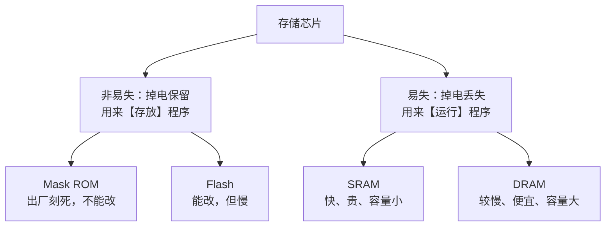
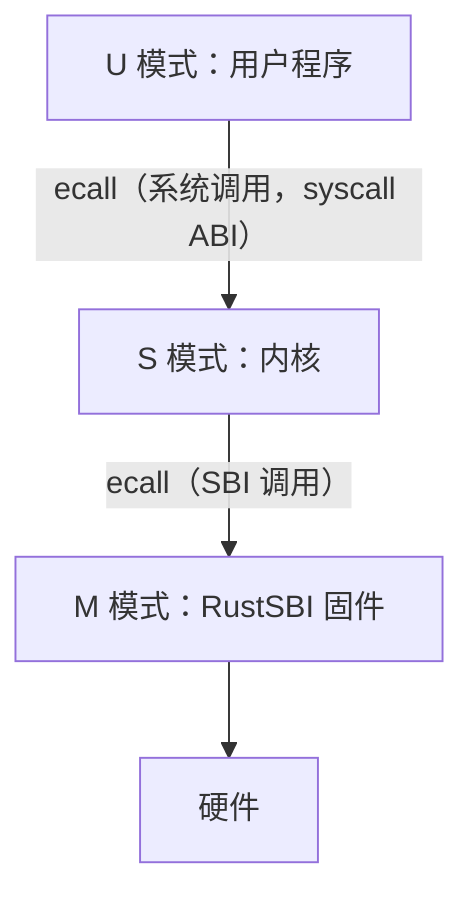
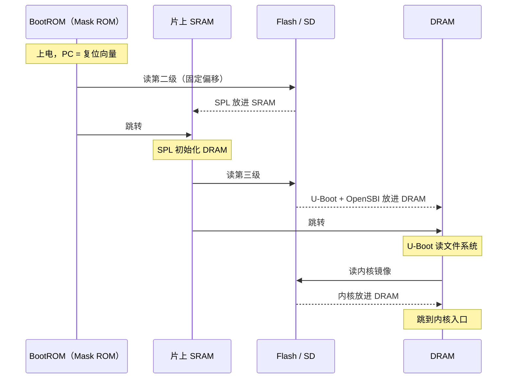
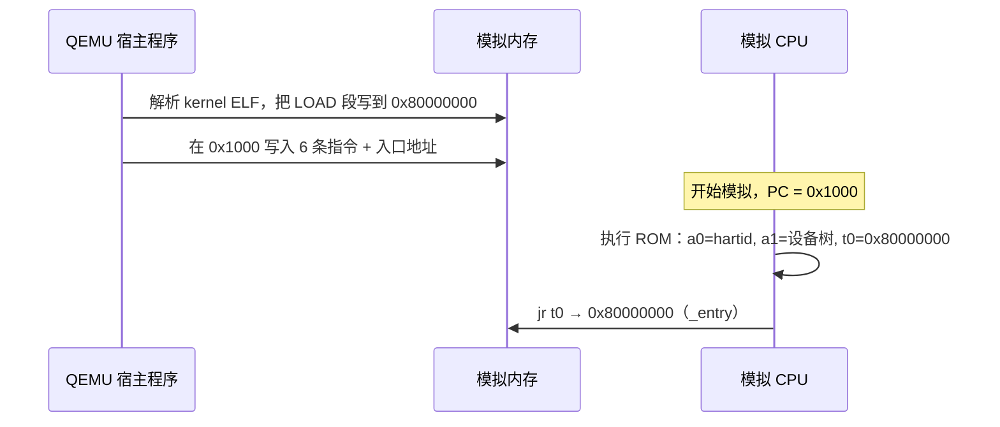
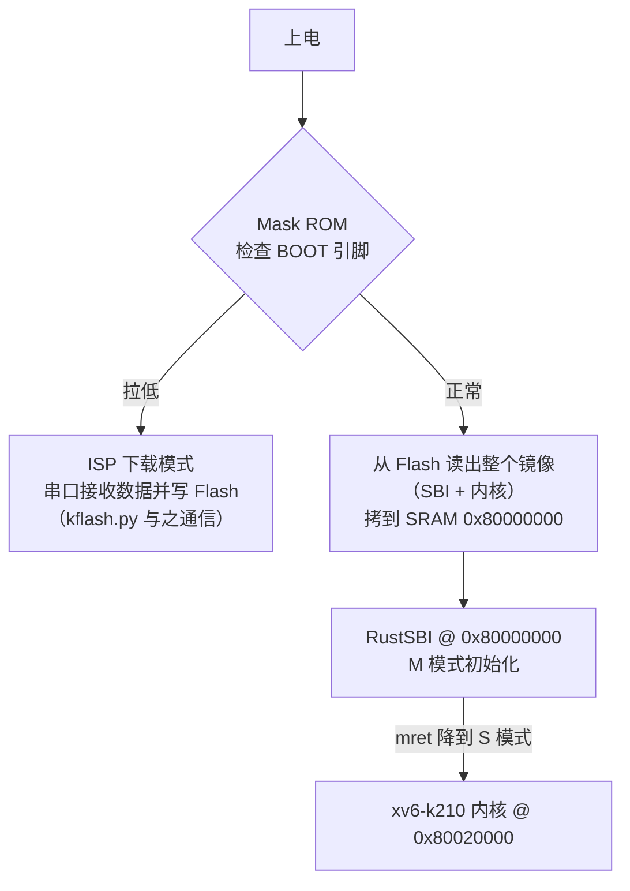
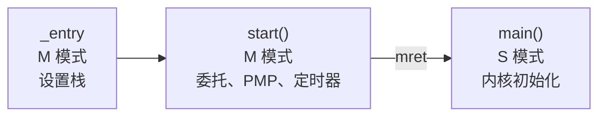
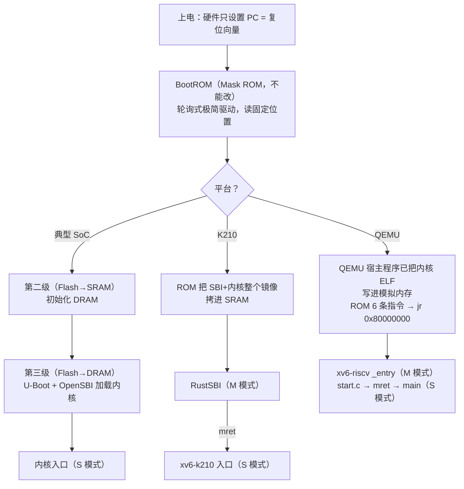

# 1. 启动（Bootstrapping）：从上电到进入内核

> 本篇回答一个问题：**按下电源到内核的第一条指令开始执行，中间发生了什么？**
> 以 xv6-riscv（QEMU）为主线，对照 xv6-k210（真实开发板 + RustSBI）。

---

## 1.1 一句话总览

**硬件只做一件事：上电时把 PC 设成一个固定地址（复位向量），然后开始取指执行。**
后面"把内核搬进内存、跳过去"这些工作全都是**软件**完成的，只是这些软件被固化在芯片里（固件）。
因为一开始能用的程序很小、能力很弱，所以要**一级一级接力**，每一级把下一级更大、更强的程序搬进内存，这个过程叫**自举（bootstrapping）**。名字来自"拽着自己的鞋带（bootstrap）把自己提起来"。


---

## 1.2 前置知识：四种存储

CPU 只能执行**内存里**的指令。所以启动时既需要一个**掉电不丢**的地方存放程序，也需要一个**读写快**的地方运行程序。启动链拷来拷去，就是在这两类存储之间搬运。



### Mask ROM
- ROM = Read-Only Memory。**Mask（掩膜）**指芯片光刻用的"底片"，数据在制造时就由电路连线决定。
- **出厂后一个比特都改不了**，但也因此绝对可靠，断电、刷坏固件都影响不到它。
- 用途：存放上电后执行的**第一段代码**，复位向量就指向这里。

### Flash
- 身边的例子：U 盘、SD 卡、手机存储、SSD。
- 原理：用绝缘层包围的"浮栅"困住电子来表示 0/1，断电后电子跑不掉。
- 特点：**能改，但必须先整块擦除再写**，擦写次数有上限；读取也比内存慢（常通过 SPI 串行总线读）。
- 用途：存放固件、操作系统镜像。`kflash.py` 烧写的就是 K210 板上的 SPI Flash。

### SRAM 和 DRAM（CSAPP 6.1）

| | SRAM（静态） | DRAM（动态） |
|---|---|---|
| 每比特结构 | 6 个晶体管组成双稳态电路 | 1 个晶体管 + 1 个电容 |
| 保存方式 | 通电就一直保持 | 电容漏电，要每几十 ms **刷新**一次 |
| 速度 | ~1ns | ~50–100ns |
| 成本 / 密度 | 贵、做不大 | 便宜、能做很大 |
| 用途 | CPU Cache、片上小内存 | 内存条（DDR4/DDR5） |

"静态"指不用管它数据也一直在，"动态"指必须不停刷新。

**和启动的关系**：DRAM 要先由内存控制器配置好时序、开启刷新才能用，**刚上电时用不了**；片上 SRAM 通电即可使用。所以早期引导代码只能在 SRAM 里运行。

| 存储 | 在启动中的角色 |
|---|---|
| Mask ROM | ① 上电后第一段代码，只负责"把下一级搬进来" |
| Flash | 存放 SBI、引导程序和内核镜像，等着被搬 |
| SRAM | ② 刚上电时就能直接用的内存 |
| DRAM | ③ 容量大的主内存，初始化之后才能用 |

---

## 1.3 固件（Firmware）

**固件是存放在设备非易失存储（ROM / Flash）里、直接控制硬件的软件。**
它本质上也是程序（机器码），但被"固化"在设备里、随硬件出厂、很少更新。*firm* 介于 *hard* 和 *soft* 之间。

| 设备 | 固件 | 作用 |
|---|---|---|
| PC 主板 | BIOS / UEFI | 自检、初始化内存、引导操作系统 |
| SSD | 主控固件 | 翻译读写请求、磨损均衡 |
| 路由器、键盘 | 设备固件 | 设备的全部逻辑 |
| RISC-V 板 | RustSBI / OpenSBI | 启动内核，并**常驻 M 模式提供服务** |

**固件和操作系统的区别**：操作系统存放在文件系统里，管理"多个程序怎么共享硬件"；固件存放在固定的芯片位置，负责"让这块硬件能工作"，并把硬件差异包装成统一接口交给上层。

### SBI：启动完不退出的固件

RISC-V 有三个特权级，SBI 固件在内核启动后**仍然驻留在 M 模式**：



xv6-k210 里的 `sbi_shutdown()` 就是：在寄存器里放好"关机"功能号，**内核自己执行一条 `ecall`**，陷入 M 模式，由 RustSBI 去操作硬件。这和用户程序执行 ecall 陷入内核是**同一个机制，往下挪了一层**。SBI = Supervisor Binary Interface，*Supervisor* 指 S 模式的内核。

---

## 1.4 典型的多级引导链（有 DRAM 的平台）

| 级 | 存放位置 | 运行位置 | 任务 |
|---|---|---|---|
| 第一级 BootROM | Mask ROM（不能改） | ROM 原地执行，栈用片上 SRAM | 根据启动引脚选择介质，把第二级读进 SRAM |
| 第二级 SPL / FSBL | Flash / SD（能改） | 片上 SRAM（几十 KB） | 初始化时钟、**DRAM 控制器**；把第三级读进 DRAM |
| 第三级 U-Boot 等 | Flash / SD | DRAM | 读文件系统、网络启动、菜单；加载内核（RISC-V 上同时装好 OpenSBI） |



真实例子：SiFive HiFive Unmatched 是 ZSBL（ROM）→ U-Boot SPL（片上 SRAM，初始化 DDR）→ OpenSBI + U-Boot（DDR）→ Linux。

**第一级和后续各级都算固件**，但**只有第一级在 Mask ROM 里**，后面几级都在 Flash 中，可以升级。

### 为什么第一级不直接拷内核？

Mask ROM 出厂后不能改，所以必须**尽量小、尽量简单**：
1. **DRAM 初始化和具体主板有关**：同一颗 CPU 搭配不同的内存颗粒，时序参数不同，芯片厂做 ROM 时无法预知，只能交给可以修改的第二级。
2. **内核的位置、格式、所在文件系统各家不同**：全部写进 ROM 会让 ROM 变大，bug 也会变多。
3. **ROM 里的 bug 永远修不了**：例如 Nintendo Switch 的 Tegra X1 BootROM 在 USB 恢复模式中存在缓冲区溢出（Fusée Gelée，2018），已出厂的机器全部无法修补。

设计原则：**ROM 只负责把下一级可靠地读进来，其余工作都交给可以更新的下一级。**

---

## 1.5 BootROM 里的"极简驱动"

ROM 里有驱动，写法和 xv6 的驱动一样，只是更简陋：
- **轮询（polling）**：不使用中断，在循环中反复读状态寄存器，直到设备就绪。
- **只读固定位置**：镜像放在 Flash 约定的偏移处，不需要文件系统。
- **几乎不用栈，没有 malloc**。
- 往往还带一个**下载模式**（串口 / USB），用于烧写 Flash。

示意代码（K210 的 ROM 未公开，下面的寄存器地址和镜像头格式是虚构的；SPI NOR Flash 的读命令 `0x03` 是业界通用的）：

```c
#define SPI_BASE    0x54000000                     // 示意地址
#define SPI_STATUS  (*(volatile uint32*)(SPI_BASE + 0x00))
#define SPI_DATA    (*(volatile uint32*)(SPI_BASE + 0x04))
#define TX_READY    (1 << 0)
#define RX_VALID    (1 << 1)

// SPI 全双工：每发一个字节，同时收回一个字节
static uint8 spi_xfer(uint8 out) {
    while (!(SPI_STATUS & TX_READY)) ;   // 轮询：等发送缓冲区空
    SPI_DATA = out;
    while (!(SPI_STATUS & RX_VALID)) ;   // 轮询：等收到数据
    return SPI_DATA;
}

static void flash_read(uint32 addr, uint8 *dst, uint32 n) {
    cs_low();                            // 片选
    spi_xfer(0x03);                      // READ 命令
    spi_xfer(addr >> 16);                // 24 位地址，高字节在前
    spi_xfer(addr >> 8);
    spi_xfer(addr);
    for (uint32 i = 0; i < n; i++)
        dst[i] = spi_xfer(0x00);         // 发空字节，把数据"挤"出来
    cs_high();
}

void rom_main(void) {
    if (boot_pin_is_low())
        isp_uart_loop();                 // 下载模式（kflash.py 就是和它通信）
    uint32 size;
    flash_read(0, (uint8*)&size, 4);     // 镜像头：长度
    flash_read(4, (uint8*)0x80000000, size);
    ((void (*)(void))0x80000000)();      // 跳过去，永不返回
}
```

对比 xv6 的 [kernel/uart.c](../kernel/uart.c) 中 `uartputc_sync`：

```c
while ((ReadReg(LSR) & LSR_TX_IDLE) == 0)   // 轮询：等发送寄存器空
    ;
WriteReg(THR, c);                            // 写一个字节
```

两者是同一个模式：**等状态寄存器的某一位就绪，再读写数据寄存器。** 驱动的本质就是"按设备手册规定的顺序读写几个固定地址（MMIO）"。

---

## 1.6 ELF：内核本身是什么格式

**内核 `kernel/kernel` 是一个完整的 ELF 文件**，和用户程序 `user/_cat` 格式相同（CSAPP 第 7 章）。

| 部分 | 作用 | 给谁看 |
|---|---|---|
| ELF 头 | 魔数 `\x7fELF`、架构、**入口地址** | 加载器 |
| Program Headers（segment） | 文件的哪一段放到内存哪里、权限 | **加载器（运行时只看它）** |
| 各个 section（.text/.data…） | 实际内容 | — |
| Section Headers | 细分的节、符号表、调试信息 | 链接器、gdb |

实测 `readelf` 的结果：

```
kernel/kernel
  Entry point address:  0x80000000                 ← _entry，由 kernel.ld 安排
  LOAD  Offset 0x1000  VirtAddr 0x80000000  FileSiz 0xa270  MemSiz 0x235a8  RWE

user/_cat
  Entry point address:  0xf6                       ← ulib.c 的 start()
  LOAD  VirtAddr 0x0     FileSiz 0xedc  R E        ← 代码
  LOAD  VirtAddr 0x1000  FileSiz 0x0    MemSiz 0x220  RW   ← 数据（全是 .bss）
```

`MemSiz > FileSiz` 多出来的部分就是 **.bss**（如 `proc[NPROC]`、`stack0`）：它们的初值全为 0，文件里不必存储，加载时清零即可。

| | 内核 | 用户程序 |
|---|---|---|
| 谁加载 | QEMU（`-kernel`） | xv6 的 `kexec()`（[exec.c](../kernel/exec.c)） |
| 存在哪 | 宿主机上的文件 | fs.img 磁盘镜像 |
| 放到哪 | 物理地址 0x80000000 | 进程虚拟地址 0 起 |

**ROM 和 SBI 通常不认识 ELF**，只会"把一坨字节原样拷到某地址、跳到开头"。所以真板上要用 `objcopy -O binary` 去掉头部，只保留按地址排好的原始字节（raw binary）。

---

## 1.7 QEMU + xv6-riscv：模拟器的捷径

QEMU 参数：`-machine virt -bios none -kernel kernel/kernel`，其中 `-bios none` 表示**不使用任何固件**。

用 `-S` 让 CPU 在第一条指令之前停住，在 monitor 里观察：

**① 上电时 PC = 0x1000**（QEMU 提供的 boot ROM，见 [memlayout.h](../kernel/memlayout.h) 注释）

**② ROM 里只有 6 条指令**

```asm
0x1000:  auipc t0, 0           # t0 = 0x1000
0x1004:  addi  a2, t0, 40
0x1008:  csrr  a0, mhartid     # a0 = CPU 编号
0x100c:  ld    a1, 32(t0)      # a1 = [0x1020] = 0x87e00000（设备树地址）
0x1010:  ld    t0, 24(t0)      # t0 = [0x1018] = 0x80000000
0x1014:  jr    t0              # 跳到内核
```

**③ CPU 一条指令都没执行时，0x80000000 处已经是内核代码**

```asm
0x80000000:  auipc sp, 10      ← entry.S 的 la sp, stack0
```

拷贝内核的是 **QEMU 这个宿主程序本身**：它在模拟开始前读取 ELF，按 Program Header 把段直接写进"模拟内存"数组，再把入口地址填进 ROM 的数据区。这是模拟器才能用的捷径，**启动阶段完全不读磁盘**。fs.img 要等内核起来后由内核自己的 virtio 驱动读取（第一次读取发生在 `forkret` 里的 `fsinit`）。



自己复现（在本仓库 `make` 之后）：

```bash
qemu-system-riscv64 -machine virt -bios none -kernel kernel/kernel -m 128M \
    -nographic -S -monitor stdio -serial none
(qemu) info registers      # 看 pc
(qemu) xp /6i 0x1000       # ROM 指令
(qemu) xp /2xg 0x1018      # 入口地址、设备树地址
(qemu) xp /4i 0x80000000   # 已经拷好的内核
```

---

## 1.8 K210 真板 + xv6-k210

K210 **没有外接 DRAM**，只有片上 8MB SRAM，所以"初始化 DRAM"这一级不存在，引导链很短。

镜像在宿主机上是这样打包的（xv6-k210 Makefile）：

```make
objcopy kernel  --strip-all -O binary k210.img   # 内核：去掉 ELF 头
objcopy RustSBI --strip-all -O binary k210.bin   # SBI：同样处理
dd if=k210.img of=k210.bin bs=128k seek=1        # 内核贴在 SBI 后 128KB 处
kflash.py ... k210.bin                           # 烧进 SPI Flash
```



要点：
- 内核与 SBI **拼成一个镜像**，由 ROM **一次全部拷进 SRAM**。所以在 K210 上，内核实际上是被第一级直接拷进内存的，RustSBI 只负责初始化和跳转。
- **三个数字必须对得上**：`dd` 偏移 128KB = 0x20000；RustSBI 的跳转目标 0x80020000；[linker/k210.ld](../../xv6-k210/linker/k210.ld) 中的 `BASE_ADDRESS = 0x80020000`。错一个就起不来。
- 在 QEMU 上跑 xv6-k210 时（`-bios sbi-qemu`），内核链接地址是 `0x80200000`（[linker/qemu.ld](../../xv6-k210/linker/qemu.ld)）。

---

## 1.9 交接点：内核的第一条指令

无论走哪条路，最后都是跳到内核入口。两个版本在这里出现分歧：

| | xv6-riscv（`-bios none`） | xv6-k210（RustSBI） |
|---|---|---|
| 进入内核时的特权级 | **M 模式** | **S 模式** |
| 谁做 M 模式的初始化 | 内核自己的 [start.c](../kernel/start.c) | RustSBI |
| 需要关机、设定时器时 | 直接操作硬件 / CSR | `ecall` 请求 SBI |

xv6-riscv 的接手过程：

1. [entry.S](../kernel/entry.S) `_entry`：每个 CPU 设置 `sp = stack0 + (hartid+1)*4096`，`call start`。C 函数需要栈，而刚上电时 `sp` 中没有有效值。
2. [start.c](../kernel/start.c) `start()`（M 模式）：
   - `mstatus.MPP = S`、`mepc = main`；
   - 把所有异常和中断**委托**给 S 模式（`medeleg/mideleg = 0xffff`）；
   - 配置 PMP，允许 S 模式访问全部内存；开启 sstc，让 S 模式可以直接设定时钟中断；
   - `tp = hartid`；
   - 执行 `mret`：**伪造一次"从异常返回"**，落到 S 模式的 `main()`。



xv6-riscv 里 `start.c` 做的事，就是 xv6-k210 里 RustSBI 替内核做好的事，**所以 xv6-k210 没有 start.c**。

> 降低特权级的唯一方式是**"假装从陷入返回"**（`mret` / `sret`）。之后内核第一次进入用户态时，用的也是同一个手法（`sret`）。

---

## 本章小结



- 硬件只负责设置复位向量，其余全是软件（固件）。
- 存放用 ROM / Flash，运行用 SRAM / DRAM；DRAM 要初始化后才能用。
- ROM 必须小而可靠，所以只负责"把下一级搬进来"；与具体主板相关的事交给可更新的后续各级。
- 内核是 ELF；ROM / SBI 通常不认识 ELF，所以真板要用 `objcopy -O binary`，并手动对齐偏移和链接地址。
- QEMU `-kernel` 是模拟器捷径：宿主程序直接写模拟内存。
- SBI 是常驻 M 模式的固件；内核通过 `ecall` 请求它服务，和用户程序做系统调用是同一个机制。
- xv6-riscv 的 `start.c` 相当于自己当 SBI；xv6-k210 由 RustSBI 代劳。
