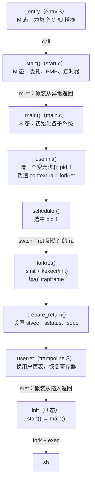
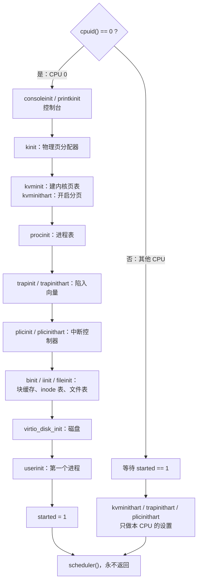
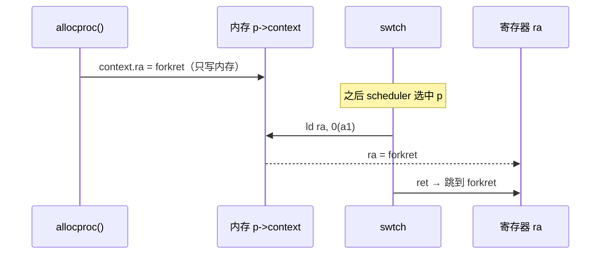
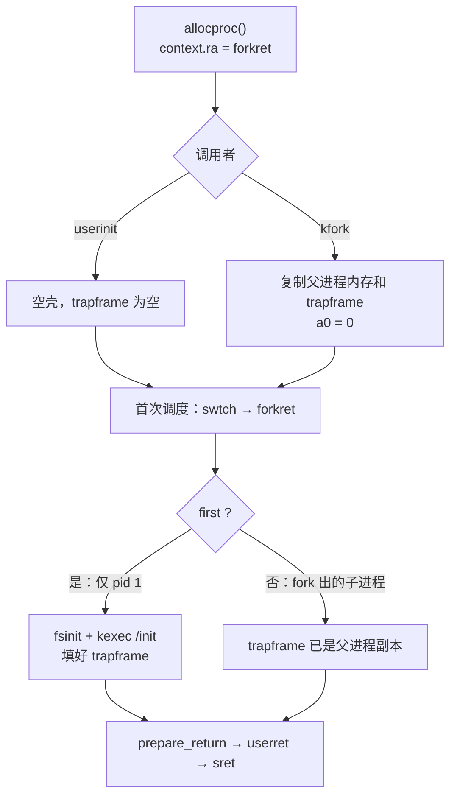
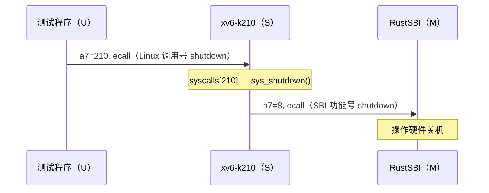
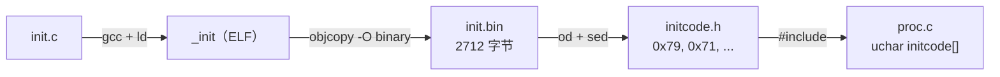
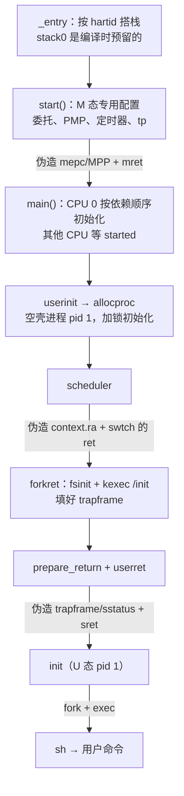

# 2. 内核初始化：从内核入口到第一个用户进程

> 本篇回答：**CPU 跳到内核第一条指令之后，经过哪些步骤，最终在 U 态运行起第一个用户程序 init？**
> 范围：`_entry` → `start()` → `main()` → `userinit()` → `scheduler()` → `forkret()` → `sret` → `init`。
> `main()` 里各子系统初始化（`kinit`、`kvminit`……）的**内部实现**这里只列出名字，在后续篇章展开。
> 上一篇：[1_bootstrapping.md](1_bootstrapping.md)（上电到内核入口）。

---

## 2.1 总览

**名字**：从上电到用户态整体叫**启动 / 引导（boot）**；本篇这一段叫**内核初始化（kernel initialization）**，终点是**创建第一个用户进程（init 进程）**。
Linux 的对应路径：`start_kernel()` → `rest_init()` → `kernel_init()` → 执行 `/sbin/init`。



### 贯穿全篇的手法：伪造现场，然后"返回"

整个过程中**没有一次"直接跳到低特权级"或"直接启动新进程"**，每次都是先伪造一份"上次的现场"，再执行一条恢复现场的指令：

| 伪造什么 | 在哪伪造 | 用哪条指令"返回" | 效果 |
|---|---|---|---|
| `mepc = main`，`mstatus.MPP = S` | `start()` | `mret` | M 态 → S 态的 `main` |
| `p->context.ra = forkret`，`sp = 内核栈` | `allocproc()` | `swtch` 末尾的 `ret` | 调度器 → 新进程的 `forkret` |
| `trapframe->epc = 入口`，`sp = 用户栈`，`sstatus.SPP = U` | `kexec()` + `prepare_return()` | `sret` | S 态 → U 态的 init |

**RISC-V 降低特权级的唯一方式就是 `xRET`**，所以只能"假装从异常 / 陷入返回"。

---

## 2.2 预备：RISC-V 汇编速成（x86 对照）

### 与 x86-64（AT&T）的五个主要区别

| | x86-64 AT&T | RISC-V |
|---|---|---|
| 操作数顺序 | 目标在**右**：`addq %rax, %rsp` | 目标在**左**：`add sp, sp, a0`（sp = sp + a0） |
| 操作数个数 | 两个 | 三个 |
| 访存 | 多数指令可带内存操作数 | **只有 load/store 访存** |
| 条件跳转 | `cmp` 设标志位 + `jcc` | 无标志位：`blt a0, a1, L` 一步完成 |
| 调用 | `call` 把返回地址**压栈** | `jal` 把返回地址放进 **`ra` 寄存器** |

**大小后缀的坑**：RISC-V 的 `w` = 4 字节、`d` = 8 字节；AT&T 的 `w` = 2 字节、`q` = 8 字节。

### 寄存器

| RISC-V | 用途 | x86-64 |
|---|---|---|
| `zero` | 恒为 0 | 无 |
| `ra` | 返回地址 | 无（在栈上） |
| `sp` | 栈指针 | `%rsp` |
| `a0`~`a7` | 参数；`a0` 兼返回值；`a7` 放系统调用号 | `%rdi %rsi …`，`%rax` |
| `t0`~`t6` | 临时，调用者保存 | `%r10 %r11` 等 |
| `s0`~`s11` | 被调用者保存；`s0` 兼帧指针 | `%rbx %rbp %r12`~`%r15` |
| `tp` | 线程指针（xv6 用来存 CPU 编号） | 类似 `%gs` |
| CSR（`satp`、`mepc`…） | 控制状态寄存器 | 控制寄存器 / MSR（`satp` ≈ `%cr3`） |

### 本篇用到的指令

| RISC-V | 含义 | x86-64 |
|---|---|---|
| `add / addi / mul` | 加 / 加立即数 / 乘 | `addq / imulq` |
| `ld rd, off(rs)` | rd = 内存[rs+off]，8 字节 | `movq off(%rs), %rd` |
| `sd rs2, off(rs1)` | 内存[rs1+off] = rs2（**数据在左**） | `movq %rs2, off(%rs1)` |
| `lui rd, imm` | rd = imm << 12 | — |
| `auipc rd, imm` | rd = pc + (imm << 12) | `leaq sym(%rip)` |
| `jal / jalr` | 跳转并把返回地址写进 rd | `call` |
| `csrr / csrw` | 读 / 写 CSR | `rdmsr / wrmsr`、`mov %cr3` |
| `ecall` | 陷入更高特权级 | `syscall` |
| `mret / sret` | 从陷入返回并降特权级 | `sysret / iret` |
| `sfence.vma` | 刷新 TLB | `invlpg` |
| `wfi` | 等中断 | `hlt` |

### 伪指令（汇编器展开）

| 伪指令 | 展开成 |
|---|---|
| `li rd, imm` | `addi` 或 `lui`+`addi` |
| `la rd, sym` | `auipc` + `addi`（或 `ld` 从 GOT 取） |
| `mv rd, rs` | `addi rd, rs, 0` |
| `j L` | `jal zero, L` |
| `call f` | `jal ra, f` |
| `ret` | `jalr zero, 0(ra)` |

另外，压缩指令（C 扩展）只有 2 字节，所以反汇编里的地址步长有时是 2、有时是 4。

---

## 2.3 `_entry`：为 C 代码搭好栈

源码：[kernel/entry.S](../kernel/entry.S)

### 为什么需要它

1. C 代码需要栈（局部变量、保存 `ra`）。刚上电时 `sp` 是随机值。
2. QEMU 默认 3 个 CPU（`-smp 3`）**同时**从 0x80000000 执行这段代码，每个 CPU 都需要**自己的**栈。
3. "设置 `sp`"这件事本身不能用 C 写，因为 C 函数的开头就要用栈。

**一句话：`_entry` 是汇编世界通往 C 世界的桥，先搭好栈，再把控制权交给 C。**

### 栈从哪来：`stack0`

[kernel/start.c](../kernel/start.c)：

```c
// entry.S needs one stack per CPU.
__attribute__((aligned(16))) char stack0[4096 * NCPU];   // NCPU = 8，共 32KB
```

- 这是**写给编译器的声明，不是给 CPU 执行的命令**。空间在**编译链接时**就由链接器分配好（实测地址 0x8000a2a0，在 .bss 段，不占 ELF 文件空间），比任何代码运行都早。
- 写在 `start.c` 里只是图方便（能直接用 `NCPU`），和 `start()` 函数毫无关系；写在任何文件里，链接后都一样。
- 栈只能这样在编译时预留：局部变量需要栈才能存在，`kalloc()` 也要栈而且还没初始化。
- `aligned(16)`：RISC-V 调用约定要求 `sp` 16 字节对齐。

```
          ┌──────────┐ ← stack0 + 4096×3   CPU 2 的 sp 初值
          │  第 2 格  │
          ├──────────┤ ← stack0 + 4096×2   CPU 1 的 sp 初值
          │  第 1 格  │
          ├──────────┤ ← stack0 + 4096×1   CPU 0 的 sp 初值
          │  第 0 格  │
          └──────────┘ ← stack0 = 0x8000a2a0
```

栈**向下**增长，所以 `sp` 要指向自己那一格的**顶部**：`sp = stack0 + 4096 × (hartid + 1)`。

### 逐行（以 CPU 1 为例）

| 代码 | 含义 | 结果 | x86 对照 |
|---|---|---|---|
| `la sp, stack0` | sp = stack0 的地址 | sp = 0x8000a2a0 | `leaq stack0(%rip), %rsp` |
| `li a0, 1024*4` | a0 = 4096 | a0 = 0x1000 | `movq $4096, %rdi` |
| `csrr a1, mhartid` | 读本 CPU 编号（只有 M 态能读） | a1 = 1 | （读 APIC ID） |
| `addi a1, a1, 1` | a1 += 1 | a1 = 2 | `addq $1, %rsi` |
| `mul a0, a0, a1` | a0 *= a1 | a0 = 0x2000 | `imulq %rsi, %rdi` |
| `add sp, sp, a0` | sp += a0 | sp = 0x8000c2a0 | `addq %rdi, %rsp` |
| `call start` | ra = 返回地址，跳到 start | | `call start` |
| `spin: j spin` | 死循环 | | `jmp .` |

实测反汇编（`la` 展开成了 `auipc` + 从 GOT 取地址的 `ld`）：

```asm
80000000:  auipc sp, 0xa          # sp = pc + 0xa000 = 0x8000a000
80000004:  ld    sp, 600(sp)      # sp = 内存[0x8000a258]（GOT 中存着 0x8000a2a0）
80000008:  lui   a0, 0x1          # li a0, 4096
8000000a:  csrr  a1, mhartid
8000000e:  addi  a1, a1, 1
80000010:  mul   a0, a0, a1
80000014:  add   sp, sp, a0
80000016:  jal   80000058 <start>
8000001a:  j     8000001a <spin>
```

### `spin` 的作用

`start()` 以 `mret` 结束，正常情况下**永远不会返回**。`spin` 是兜底：万一 `start()` 用 `ret` 返回了，CPU 停在这里空转，而不会顺着地址"掉进"紧随其后的 `timerinit`，跑到不可预测的地方。
它**不是**错误处理：`start()` 内部如果发生异常，CPU 会跳到 `mtvec`，而 xv6 从未设置 `mtvec`。xv6 的启动早期没有任何错误处理。

### C 代码与手写汇编的区别

编译器生成的 C 代码默认 ABI 约定成立，**一上来就操作栈**。实测 `start()` 的开头：

```asm
80000058 <start>:
  addi sp, sp, -16      # 开栈帧            subq $16, %rsp
  sd   ra, 8(sp)        # 保存 ra           （x86 的 call 已自动压栈）
  sd   s0, 0(sp)        # 保存帧指针         pushq %rbp
  addi s0, sp, 16       # 新帧指针           movq %rsp, %rbp
  csrr a5, mstatus      # ← 这才是第一行 C 代码
```

手写的 `.S` 没有任何默认前提，用不用栈由写的人决定：

| 文件 | 用不用栈 | 原因 |
|---|---|---|
| `entry.S` | 不用，它负责**建立**栈 | 还没有栈 |
| `trampoline.S` 的 `uservec` | **不能用** | 此时 `sp` 还是用户栈，不可信 |
| `kernelvec.S` | 用 | 已在内核中，`sp` 可信 |

**C 编译出的代码依赖 ABI 约定；汇编可以在约定还不成立时运行，负责把约定建立起来。**

### 细节

- **RISC-V 的 `call` 本身不需要栈**（返回地址进 `ra`）；x86 的 `call` 要压栈，所以必须先设好 `%rsp` 才能 `call`。
- **xv6 没有清零 .bss**：依赖 QEMU 给的内存初始全为 0。真实硬件上这是潜在 bug，正规启动代码会在 `_entry` 里清零 .bss。
- **这块栈会一直使用下去**：调用链 `_entry → start → main → scheduler()` 永不返回，每个 CPU 的**调度器线程**始终使用 `stack0` 里属于自己的那 4KB。
- **没有保护页**：各格之间紧挨着，溢出会悄悄覆盖相邻 CPU 的栈（进程的内核栈则有 guard page）。

---

## 2.4 `start()`：M 态的一次性配置

源码：[kernel/start.c](../kernel/start.c)

**核心思想**：这里设置的全是 **M 态专用的寄存器**。`mret` 进入 S 态以后，内核**再也改不了它们**，所以必须趁还在 M 态时一次性设好，把权力交给 S 态。

| 代码 | 作用 | 为谁准备 |
|---|---|---|
| `mstatus.MPP = S`；`mepc = main` | 设定 `mret` 的目的地 | `mret` |
| `satp = 0` | 关闭分页（页表要到 `main` 的 `kvminit` 才建好），S 态先直接用物理地址 | `main` |
| `medeleg = 0xffff` | **异常委托**：0~15 号异常（ecall、缺页……）交给 S 态 | 系统调用、缺页 |
| `mideleg = 0xffff` | **中断委托**：中断交给 S 态 | 时钟、设备中断 |
| `sie |= SEIE | STIE` | S 态愿意接收外部中断和时钟中断 | 同上 |
| `pmpaddr0`、`pmpcfg0` | **物理内存保护**：允许 S 态访问全部物理内存（不设置则 S 态无法访问内存） | S 态访存 |
| `menvcfg.ADUE` | 硬件自动更新页表项的 A/D 位 | 以后的页表 |
| `timerinit()` | 开启 sstc，允许 S 态读时间、自设 `stimecmp`；预约第一次时钟中断 | 调度 |
| `tp = mhartid` | S 态读不了 `mhartid`，以后 `cpuid()` 从 `tp` 读 | `cpuid()` |
| `mret` | 降到 S 态，跳到 `main` | |

### `mepc` 与 `mret`

- **`mepc`**（Machine Exception Program Counter）：发生陷入时硬件把**被打断指令的地址**存在这里；`mret` 时跳回去。x86 是把 `%rip` 压栈，`iret` 弹出。
- **`mret`** 硬件动作：`pc ← mepc`；`特权级 ← mstatus.MPP`；`MIE ← MPIE`。
- `start()` 没有发生异常，而是**手动填写** `mepc` 和 `MPP`，于是 `mret` "返回"到了一个从未来过的地方：S 态的 `main`。
- 不能直接写 `main();`：普通调用不改变特权级，`main` 会在 M 态运行。

### 委托（delegation）

RISC-V 默认**所有陷入都交给 M 态**。`medeleg`/`mideleg` 的每一位对应一种原因，置 1 就是"这种情况直接转给 S 态"（像前台把电话直接转给部门经理）。x86 没有对应的概念（统一由 ring 0 的 IDT 处理）。

---

## 2.5 `main()`：内核初始化（概览）

源码：[kernel/main.c](../kernel/main.c)



- 只有 CPU 0 做全局初始化；其他 CPU 用 `started` 标志等待，然后只设置自己的寄存器（开分页、设 `stvec`、设 PLIC）。
- **调用顺序就是依赖顺序**：先有页分配器，才能建页表；先有页表，才能建进程……各函数的内部实现在后续篇章展开。
- 最后所有 CPU 都进入 `scheduler()`。

---

## 2.6 `userinit()` + `allocproc()`：造一个空壳进程

源码：[kernel/proc.c](../kernel/proc.c)

```c
void userinit(void) {
  p = allocproc();          // 返回时持有 p->lock
  initproc = p;
  p->cwd = namei("/");
  p->state = RUNNABLE;
  release(&p->lock);        // 配对解锁
}
```

这个进程（pid 1）**此时没有任何用户内存**，页表里只有 trampoline 和 trapframe 两页。

### `allocproc()`：通用的进程创建（userinit 和 kfork 共用）

```c
for (p = proc; p < &proc[NPROC]; p++) {
  acquire(&p->lock);
  if (p->state == UNUSED) goto found;     // 找到空位：带着锁往下
  else release(&p->lock);
}
return 0;
found:
  p->pid = allocpid();
  p->state = USED;
  if ((p->trapframe = kalloc()) == 0) {          // 失败情形一
    freeproc(p); release(&p->lock); return 0;
  }
  p->pagetable = proc_pagetable(p);              // 只映射 trampoline + trapframe
  if (p->pagetable == 0) {                       // 失败情形二
    freeproc(p); release(&p->lock); return 0;
  }
  memset(&p->context, 0, sizeof(p->context));
  p->context.ra = (uint64)forkret;               // ← 伪造：首次调度从 forkret 开始
  p->context.sp = p->kstack + PGSIZE;            //   使用自己的内核栈
  return p;                                      // 成功：带着锁返回
```

| 调用者 | 场景 | 之后补上的内容 |
|---|---|---|
| `userinit()` | 开机一次 | 什么都不补，留给 `forkret` 里的 `kexec` |
| `kfork()` | 每次 `fork()` | 复制父进程内存（`uvmcopy`）、trapframe（再令 `a0 = 0`）、打开的文件 |

**所以每个新进程第一次被调度时都从 `forkret` 开始执行**（函数名的由来：fork return）。

### 锁：为什么要跨函数加锁 / 解锁

- `proc[]` 被所有 CPU 共享，每个 CPU 的 `scheduler()` 都在扫描它（`acquire(&p->lock)` → 检查 RUNNABLE）。
- 从 `allocproc` 加锁到调用者 `release`，覆盖了"初始化一个新进程"的全过程，防止别的 CPU 运行一个只初始化了一半的进程。
- 开机时其他 CPU 还在等 `started`，不会来抢；但 `fork` 时会，所以 `allocproc` 必须按"有人会抢"的标准来写。
- **忘记 `release` 的后果**：所有调度器扫描到这个槽时都卡在 `acquire` 里，系统挂死。
- 自旋锁实现：`__atomic_exchange_n` → `amoswap.w.aq`（≈ x86 `xchg`），原子地把 `locked` 设为 1 并取回旧值，旧值为 0 才算抢到；`acquire` 开头的 `push_off()` 关中断防止死锁（细节见后续"锁"篇）。

### 失败处理

两种失败都是**物理内存耗尽**（例如 fork 炸弹）：`kalloc()` 返回 0，或者 `proc_pagetable()` 里分配页表页失败。

- `freeproc(p)`：撤销做了一半的工作（释放已分配的 trapframe / 页表，`state = UNUSED`）。每一步"先检查再释放"，因此能同时处理两种情形。要求调用时持有锁，所以**先 `freeproc` 再 `release`**。
- `release`：失败时返回 0，调用者拿不到 `p`，无法解锁（`kfork` 里直接 `return -1`），只能由 `allocproc` 自己解锁。
- 原则：**无论在哪一步失败，返回时槽位都要和调用前一模一样**（UNUSED、未上锁、不占内存）。C 没有 RAII，只能手写。
- `userinit` 没检查 `allocproc` 的返回值：开机时内存一定够，属于偷懒写法。

---

## 2.7 `scheduler()` + `swtch`：切换到新进程

`main()` 最后调用 `scheduler()`，扫描到 pid 1：

```c
acquire(&p->lock);
if (p->state == RUNNABLE) {
  p->state = RUNNING;
  c->proc = p;
  swtch(&c->context, &p->context);   // a0 = &c->context, a1 = &p->context
}
```

[kernel/swtch.S](../kernel/swtch.S)：保存当前的 14 个寄存器到 `a0` 指向的结构，再从 `a1` 指向的结构装入：

```asm
swtch:
    sd ra, 0(a0)       # c->context.ra = 当前 ra
    sd sp, 8(a0)
    ...                # s0~s11
    ld ra, 0(a1)       # ra = p->context.ra = forkret   ← ra 就是在这里被换掉的
    ld sp, 8(a1)       # sp = p->context.sp = 进程内核栈顶
    ...
    ret                # 跳到 ra，即 forkret
```

### 两个"ra"

| 名字 | 是什么 |
|---|---|
| `p->context.ra` | 内存里的结构体字段（`struct context` 偏移 0） |
| `ra` | CPU 寄存器，`ret` 跳到它指向的地址 |



### 要点

- **只保存 14 个寄存器（ra、sp、s0~s11）就够了**：`swtch` 是被当作普通函数调用的，调用者保存寄存器由编译器负责处理，只需保存被调用者保存的寄存器。
- **换了 `sp` 就是换了线程**：从此 CPU 在 pid 1 的内核栈上运行。
- 对运行过的进程，`context.ra` 是它上次调用 `swtch` 时自动保存的（指向 `sched()` 里），`ret` 让它回到原处；**新进程没有"上次"，所以由 `allocproc` 伪造一份**。`swtch` 不区分两者。
- x86 的 `ret` 从栈上弹出返回地址；RISC-V 的 `ret` 跳到 `ra`，所以改 `ra` 就能控制去向。

---

## 2.8 `forkret()`：第一个进程加载 `/init`

```c
void forkret(void) {
  static int first = 1;              // 所有进程共用
  release(&p->lock);                 // scheduler 加的锁在这里释放
  if (first) {                       // 只有整个系统第一个运行的进程进入
    first = 0;
    fsinit(ROOTDEV);                 // 读超级块、初始化日志
    p->trapframe->a0 = kexec("/init", (char *[]){"/init", 0});
  }
  prepare_return();                  // 以下所有新进程都一样
  uint64 satp = MAKE_SATP(p->pagetable);
  uint64 trampoline_userret = TRAMPOLINE + (userret - trampoline);
  ((void (*)(uint64))trampoline_userret)(satp);   // 当函数调用，a0 = satp
}
```

- **为什么 `fsinit` 不放在 `main()` 里**：读磁盘要等中断，要 `sleep`，而 `sleep` 需要"当前进程"；`main()` 运行时还没有进程。这也是 xv6 要绕道 scheduler，而不在 `main()` 里直接进入用户态的原因。
- **`kexec` 填好 trapframe**（[exec.c](../kernel/exec.c)）：

  ```c
  p->trapframe->a1  = sp;          // argv
  p->trapframe->epc = elf.entry;   // init 的入口 start()
  p->trapframe->sp  = sp;          // 用户栈顶
  return argc;                     // → trapframe->a0
  ```

  此时 trapframe 已经是"init 刚要开始运行"的现场。
- fork 出的子进程跳过 `if (first)`：它们的 trapframe 是父进程的副本（`epc` 指向 `ecall` 下一条，`a0 = 0`），所以 `sret` 后从 `fork()` 返回 0。



**分工**：`context.ra = forkret` 让新进程在**内核态**首次被调度时有处可去；trapframe 的内容让它从 forkret 回到**用户态**时知道从哪继续。

---

## 2.9 `prepare_return()` + `userret`：进入 U 态

这和**每次系统调用结束返回用户态**走的是同一条路。

### `prepare_return()`（[trap.c](../kernel/trap.c)）

| 设置 | 作用 |
|---|---|
| 关中断；`stvec = uservec` | 以后用户态陷入走 trampoline |
| trapframe 的 `kernel_satp / kernel_sp / kernel_trap / kernel_hartid` | 下次陷入时 `uservec` 靠它们切回内核 |
| `sstatus.SPP = 0` | `sret` 回到 U 态 |
| `sstatus.SPIE = 1` | 回到用户态后开中断 |
| `sepc = trapframe->epc` | `sret` 跳到 init 入口 |

### `userret`（[trampoline.S](../kernel/trampoline.S)）

```asm
userret:
    fence.i                 # 刷新指令缓存（刚加载了新代码）
    sfence.vma zero, zero   # 刷新 TLB                       ≈ invlpg
    csrw satp, a0           # 换成 init 的用户页表            ≈ movq %rdi, %cr3
    sfence.vma zero, zero
    li a0, TRAPFRAME
    ld ra, 40(a0)           # 从 trapframe 恢复 31 个寄存器
    ld sp, 48(a0)           #   sp = 用户栈顶
    ...
    ld a0, 112(a0)          # 最后恢复 a0 = argc
    sret                    # pc = sepc，切到 U 态            ≈ sysret / iret
```

`sret` 之后：U 态，从 init 的 `start()`（[user/ulib.c](../user/ulib.c)）开始执行，`a0 = argc`、`a1 = argv`，`start` 再调用 `main`（实测 `_cat` 的 ELF 入口就是 `start`）。

---

## 2.10 `init` 与用户态

### init 做什么（[user/init.c](../user/init.c)）

1. 打开 `console` 得到 fd 0（不存在则先 `mknod`），`dup(0)` 两次得到 fd 1、2；
2. 循环：`fork` → 子进程 `exec("sh")` → 父进程 `wait`；
3. `wait` 同时回收被收养的孤儿；shell 退出就重启一个。

```
init (pid 1)        ← 内核亲手造的唯一用户进程
 └─ sh (pid 2)      ← init fork + exec
     └─ cat (pid 3) ← sh fork + exec
```

- **pid 从 1 开始**（`nextpid = 1`），xv6 没有 0 号进程，各 CPU 的调度器循环不是进程。Linux 的 pid 0 是 idle/swapper 内核线程，作用类似 xv6 的调度器循环。
- **init 不能退出**：`kexit` 里 `if (p == initproc) panic("init exiting")`，因为孤儿要交给它回收。
- `sh` 是**人**使用系统的入口；init 是**系统**进入用户态的入口。

### usys.pl：用户态的最后一站

[user/usys.pl](../user/usys.pl) 是**编译时在宿主机上运行**的 Perl 脚本，生成 `usys.S`。每个 `entry("fork")` 生成：

```asm
fork:
 li a7, SYS_fork     # 调用号             movq $SYS_fork, %rax
 ecall               # U 态 → S 态        syscall
 ret                 # 返回值在 a0        ret
```

`usys.o` 链接进每个用户程序（`ULIB = ulib.o usys.o printf.o umalloc.o`）。`sh.c` 里的 `fork()` 看起来是普通 C 调用，实际执行的就是这三条指令。

---

## 2.11 对照：xv6-k210

### RustSBI：别人写好的 `entry.S` + `start.c`，并且常驻

源码在 xv6-k210 的 `bootloader/SBI/rustsbi-qemu/src/main.rs`。

- **SBI** 是接口规范，**RustSBI** 是它的一个 Rust 实现（另一个常见实现是 C 写的 OpenSBI）。
- QEMU 参数 `-bios sbi-qemu`：RustSBI 的入口在 0x80000000，内核在 **0x80200000**。

| 做什么 | xv6-riscv | RustSBI |
|---|---|---|
| 每 CPU 搭栈 | `entry.S` | `_start`（同样按 hartid 计算） |
| 设置 M 态陷入入口 | **未设置** | `mtvec = _start_trap`（启动后还要接收 ecall） |
| 初始化串口、CLINT、关机设备 | 不需要 | `Ns16550a`、`Clint`、`init_reset` |
| 委托 | `0xffff` 全部委托 | 逐项委托；**故意不委托 S 态 ecall** |
| 交给内核 | `mret` 到 `main` | `mret` 到 0x80200000，`a0 = hartid`，`a1 = 设备树` |

**启动后常驻**：内核执行 `ecall` → 留在 M 态 → `start_trap_rust` 按 `a7` 分派 → 结果写回 `a0` → `mepc + 4` → `mret`。和 xv6 处理系统调用（`usertrap` → `syscall()` → `epc += 4` → `sret`）是**同一套机制，往下挪了一层**。它还负责：

- **时钟中断转发**：老硬件只有 M 态能设定时器，内核用 `sbi_set_timer()`；中断到达 M 态后，RustSBI 设置 `mip.STIP` 转交 S 态。
- **指令模拟**：硬件不支持 `rdtime` 时触发非法指令异常，RustSBI 读出时间写回目标寄存器，再跳过该指令。

所以 **xv6-k210 没有 `start.c`**，它的 `entry_qemu.S` 一开始就在 S 态：

```asm
_entry:
    add  t0, a0, 1        # a0 = hartid（SBI 传来，S 态读不了 mhartid）
    slli t0, t0, 14       # ×16384：每 CPU 16KB
    la   sp, boot_stack   # 栈区在汇编里用 .space 声明
    add  sp, sp, t0
    call main             # 直接进 main
```

### 两套 ecall 编号

| | 系统调用号 | SBI 功能号 |
|---|---|---|
| 谁和谁 | U ↔ S | S ↔ M |
| 谁规定 | 操作系统（Linux：64 = write） | SBI 规范（旧版：8 = shutdown） |
| 谁处理 | U 态 ecall（scause 8，已委托）→ 内核 | S 态 ecall（mcause 9，未委托）→ RustSBI |

同一个数字 8：`SYS_fstat_xv6 = 8`（内核处理）与 `SBI_SHUTDOWN = 8`（RustSBI 处理）互不冲突。



### 第一个用户程序怎么进入内存

| 版本 | 做法 |
|---|---|
| 上游 xv6-riscv（新版） | `userinit` 造空壳；`forkret` 里 `kexec("/init")` 从磁盘加载 |
| 老版 xv6 / xv6-k210 原版 | 内核内嵌 96 字节的 `initcode`（汇编：`exec("/init")`），由它再 exec 真正的 init |
| 我的 xv6-k210 | **内嵌整个 `init.c`**（评测磁盘上没有 `/init`） |

内嵌的流水线（Makefile）：



`userinit` 用 `uvminit` 把数组拷到地址 0，并**写死** `trapframe->epc = 0`、`sp = PGSIZE`。

- `initcode.S` 里的 `"/exit"` 是**测试程序的文件名**（测试 exit 系统调用的那个程序），不是"退出"。那是 Part 0 的临时做法：pid 1 自己变成 exit 测试，只能跑一个测试，跑完 init 退出就触发 panic，于是当时把 `panic("init exiting")` 改成了 `sbi_shutdown()`（提交 9f60fac）。
- 现在（提交 04fad67）：init 用 `fork + exec + wait` 依次运行 `tests[]`，全部完成后**主动**调用 `shutdown()`；`panic("init exiting")` 恢复原样。正常结束与出错走不同的路，bug 不会被掩盖。`initcode.S` 已是遗留文件。
- **隐患**：① 入口必须是位于地址 0 的 `main`（依赖链接顺序）；② 代码、数据、.bss 和栈要挤在一页内（目前 0xab0 = 2736 字节，栈约剩 1.3KB），测试增多后可能超出。

### 测试在用户态运行

测试程序就是普通用户程序，大部分时间在 U 态执行，只在系统调用时短暂进入 S 态。"测试内核"测的是这些系统调用在 S 态被处理得对不对。

### ELF 与 ABI

ELF 格式是统一的（测试程序和 xv6 程序都是 `ELF 64-bit RISC-V, SYSV`），不同的是 **ABI**：

| | xv6 | Linux |
|---|---|---|
| 调用号 | read = 5，write = 16 | read = 63，write = 64 |
| 参数与返回值 | `getcwd(buf)` | `getcwd(buf, size)`，返回 buf |
| 结构体布局 | xv6 的 `struct stat` | Linux 的 `struct kstat` |
| 启动时的栈布局 | `exec` 把 argc/argv 放进 `a0`/`a1` | argc、argv 在**栈上**，`_start: mv a0, sp` |

调用号已作为常数编译进测试程序的机器码（`li a7, 63`），只能改内核的分发表来适配。重新编译的 xv6 程序会自动使用 `sysnum.h` 里的新号码；保留 `SYS_fstat_xv6 = 8` 这类旧号码，可以让两种程序共存。

---

## 本章小结



- `_entry` 搭栈，`start()` 在 M 态完成只有 M 态能做的配置，`main()` 按依赖顺序初始化子系统。
- 新进程靠 `allocproc` 伪造 `context.ra = forkret` 获得第一次运行的机会；`userinit` 和 `kfork` 共用这条路。
- 第一个进程在 `forkret` 里完成文件系统初始化（需要进程上下文才能 `sleep`），并用 `kexec` 加载 `/init`。
- 进入 U 态与系统调用返回走同一条路：`prepare_return` → `userret` → `sret`。
- **三次伪造现场**（`mret`、`swtch` 的 `ret`、`sret`）是整个启动过程的主线。
- xv6-k210：RustSBI 代替 `entry.S` + `start.c` 并常驻 M 态；第一个用户程序被编译进内核的 `initcode[]`。

待深入（后续篇章）：`main()` 中各子系统的实现（物理页分配器、页表、trampoline 的地址映射、陷入处理、文件系统、锁）。
